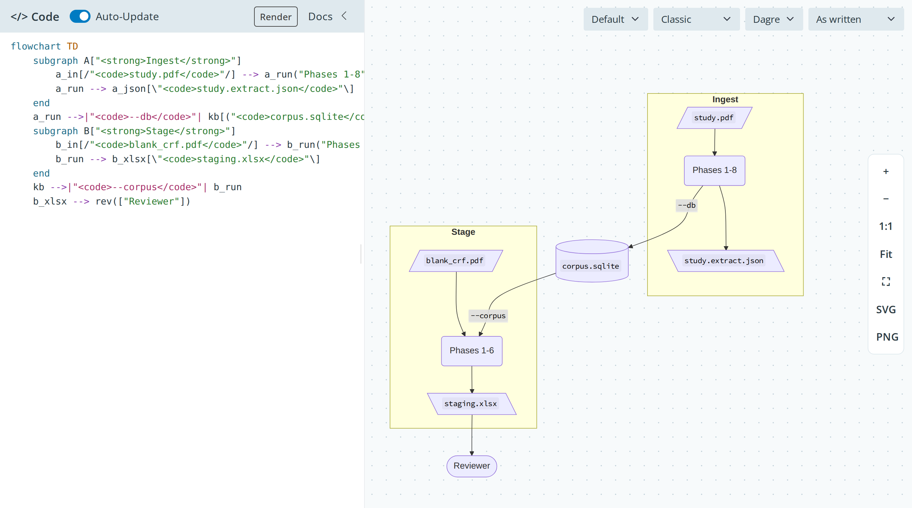

# shymermaid

A Shiny for Python (Core) app-package that renders Mermaid diagrams. Write Mermaid code in the left pane and the diagram updates on the canvas to the right.



## Features

- Code editor with Mermaid syntax highlighting in a collapsible sidebar, with an Auto-Update switch and a Render button
- Tab inserts spaces in the editor; press Escape, then Tab, to move focus out
- Theme (default, neutral, dark, forest, base), look (classic, hand drawn), layout (Dagre, ELK), and direction (as written, TD, BT, LR, RL) menus
- Pan and zoom, 1:1, fit to screen, fullscreen, and SVG or PNG download
- Parse errors show on the canvas while the last good diagram stays in place

## Install

This package uses [`uv`](https://docs.astral.sh/uv/). `uv sync` creates `.venv/`, installs the package in editable mode, and adds the `dev` group (pytest, ruff, mypy):

```bash
uv sync
```

Add `--group docs` to also install great-docs (Python 3.11 or later).

## Run

```bash
uv run shymermaid
```

Or with autoreload during development:

```bash
uv run shiny run shymermaid.app:app --reload
```

From Python:

```python
from shymermaid import run_app

run_app(port=8000)
```

The app loads Mermaid and svg-pan-zoom from jsdelivr, so it needs an internet connection.

## Use the modules in another app

```python
from shiny import App, ui

from shymermaid import editor_server, editor_ui, viewer_server, viewer_ui

app_ui = ui.page_fillable(
    ui.layout_sidebar(ui.sidebar(editor_ui("editor")), viewer_ui("viewer"))
)


def server(input, output, session):
    code = editor_server("editor")
    viewer_server("viewer", code=code)


app = App(app_ui, server)
```

The page also needs the Mermaid, svg-pan-zoom, and `www/` assets that `shymermaid.app.app_ui()` adds to the page head.

## Develop

The editor tests in `tests/test_editor_highlight.py` drive a browser with Playwright. Install its Chromium once:

```bash
uv run playwright install chromium
```

```bash
uv run pytest
uv run ruff check src tests
uv run mypy src
```

Build and preview the docs site:

```bash
uv sync --group docs
uv run great-docs build
uv run great-docs preview
```

## Layout

```
src/shymermaid/
├── __init__.py
├── diagram.py      # Shiny free helpers: set_direction(), render_config()
├── modules.py      # editor and viewer modules
├── app.py          # app_ui(), server(), create_app(), run_app()
└── www/
    ├── mermaid-binding.js
    └── styles.css
tests/
├── test_app.py
└── test_diagram.py
```
