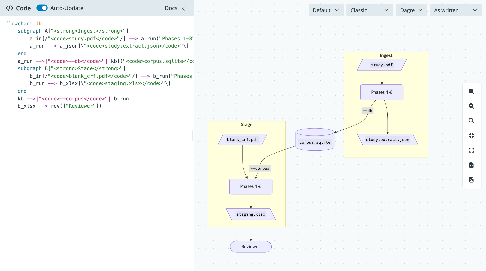
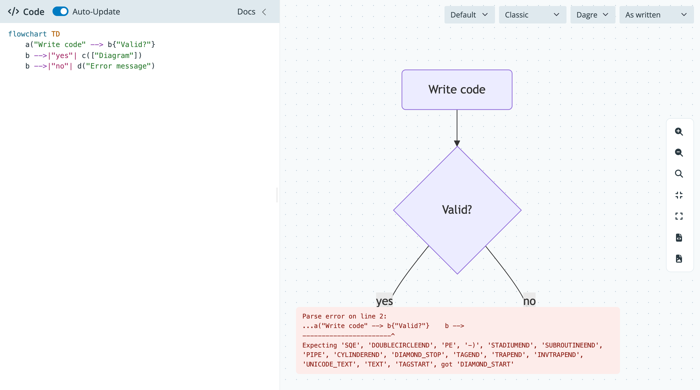
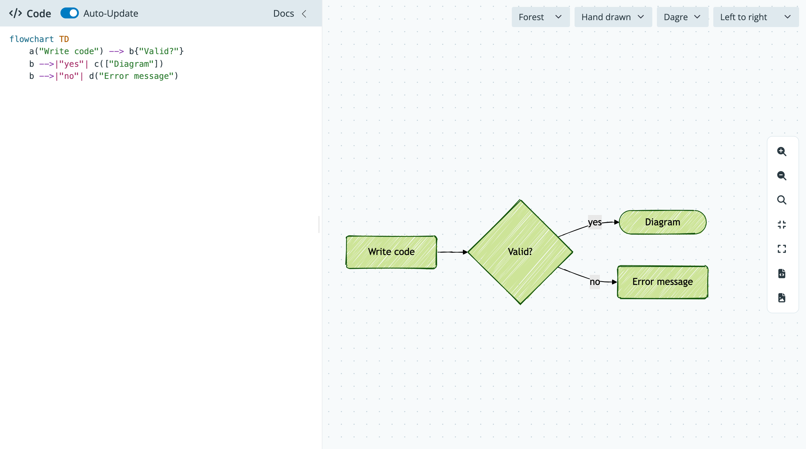

This tutorial walks through installing `shypermaid`, launching the app, and drawing a first diagram. By the end you'll have edited Mermaid code, changed the theme and direction, and saved the result as an SVG or PNG file.

## Install the package

`shypermaid` uses [`uv`](https://docs.astral.sh/uv/) for package management. Clone the repo, then run `uv sync` to create the environment and install the package with its development tools:

```bash
git clone https://github.com/mjfrigaard/shypermaid.git
cd shypermaid
uv sync
```

`uv sync` installs the package in editable mode, along with the `dev` group from `pyproject.toml`. Changes to files in `src/shypermaid/` show up the next time the app starts.

## Launch the app

The install adds a `shypermaid` command to the environment. Run it with `uv`:

```bash
uv run shypermaid
```

The command starts a server on `127.0.0.1:8000` and opens the app in a browser. The app ships its own copies of Mermaid, svg-pan-zoom, and the ELK layout plugin, so it works without an internet connection.

We can confirm the app is working by looking at the canvas. The sample flowchart from the editor should be drawn on the right side of the page.



## Edit the diagram

The editor sits in the sidebar on the left. Auto-Update is on by default, so each edit redraws the canvas. Replace the sample code with the flowchart below:

```{verbatim}
flowchart TD
    a("Write code") --> b{"Valid?"}
    b -->|"yes"| c(["Diagram"])
    b -->|"no"| d("Error message")
```

Now break the code on purpose by deleting the closing `)` on the first node. A red error message appears at the bottom of the canvas, and the last good diagram stays in place. Put the `)` back and the error goes away.



::: {.callout-tip}
Turn off Auto-Update when you're writing a long diagram. The canvas only redraws when you click Render, so half finished lines won't flash errors while you type.
:::

## Change how it looks

The menus at the top right of the canvas change the drawing without changing your code. Theme picks the color scheme, and Look switches between the classic style and a hand drawn style. Layout picks the engine that places the nodes: Dagre is the default, and ELK draws right angled edges and often untangles diagrams with many crossing links. The first time you pick ELK, the app downloads the layout plugin, so the redraw takes a moment.

Direction rewrites your code's direction before it is drawn. Pick Left to right and the flowchart turns on its side. Pick As written to go back to the direction in your code.



Direction works on four diagram types, and each one sets it in its own way:

| Diagram | What Direction changes |
|---|---|
| `flowchart`, `graph` | The header, as in `flowchart LR` |
| `stateDiagram`, `classDiagram` | The top level `direction` line (added if missing) |
| `gitGraph` | The header, as in `gitGraph TB:` (no Right to left) |
| Everything else | Nothing; the diagram is drawn as written |


## Move around and save

The tool buttons on the right edge control the view. You can also drag the canvas to pan and use the scroll wheel to zoom.

| Button | Action |
|---|---|
| `+` and `−` | Zoom in and out |
| `1:1` | Show the diagram at its actual size |
| `Fit` | Fit the whole diagram on the canvas |
| `⛶` | Enter or leave fullscreen |
| `SVG` | Download the diagram as `diagram.svg` |
| `PNG` | Download the diagram as `diagram.png` at twice its size |

Click SVG to save the diagram. The file holds the diagram as Mermaid drew it, without the pan and zoom applied. Click PNG for an image you can paste into slides or documents; it has a white background (dark gray with the Dark theme).

## Recap

We installed `shypermaid`, launched it with `uv run shypermaid`, and edited a flowchart in the sidebar. The menus change the theme, look, and direction, and the tool buttons control the view and save the SVG or PNG file. The [Embed the Modules](01.01-how-to-embed-modules.qmd) guide shows how to put the editor and viewer in your own app.
